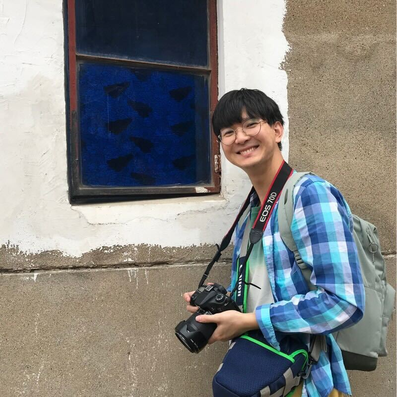
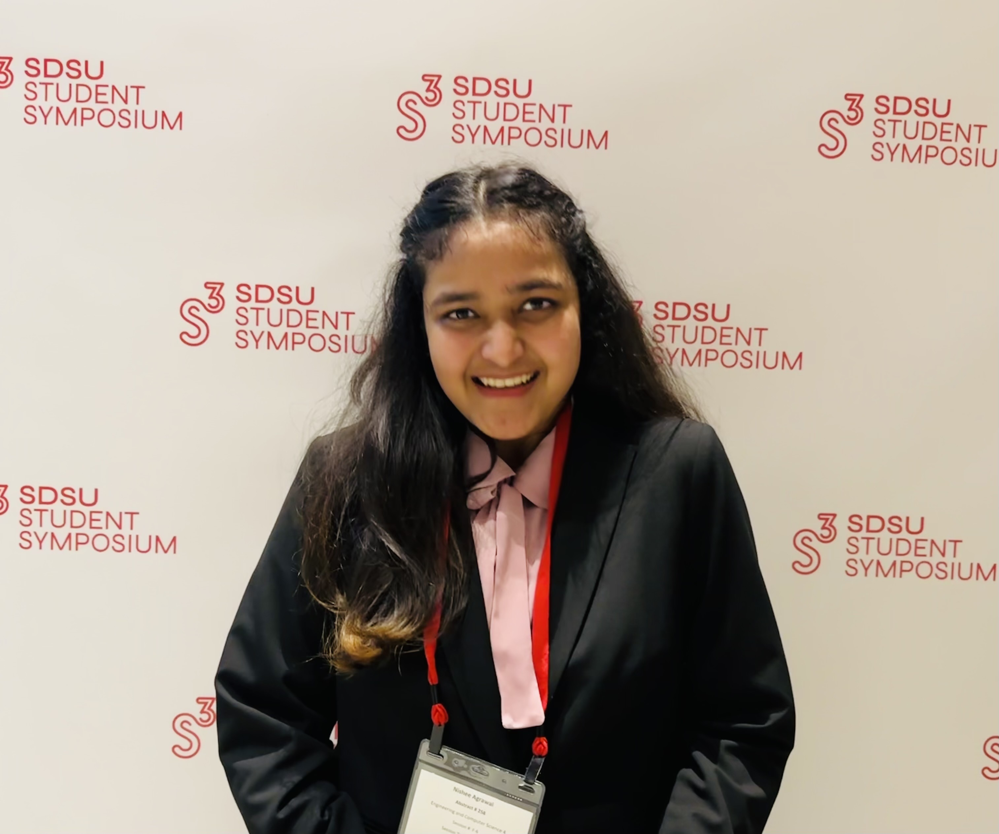
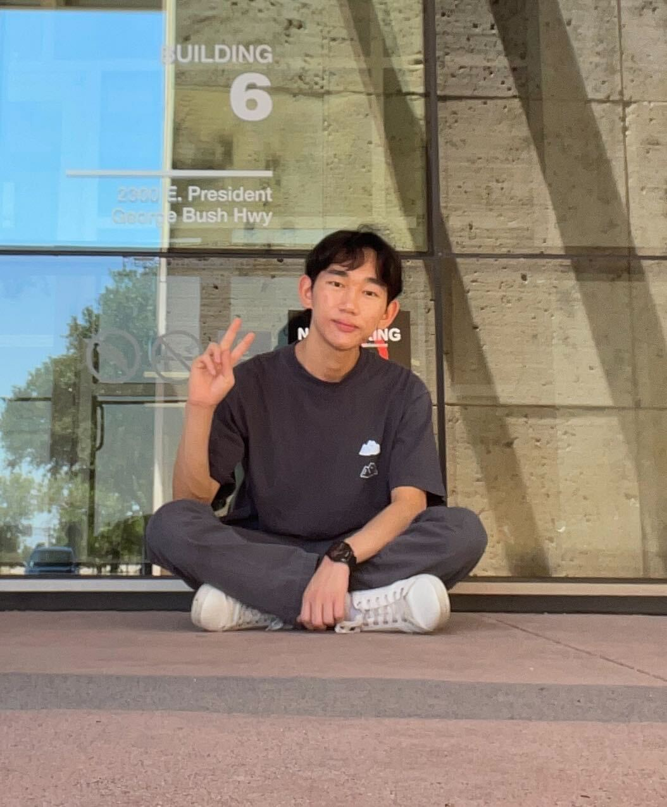

Overview
====

We are a group of researchers aiming to improve the security, resilience, and performance of widely deployed distributed systems, including public blockchain networks, social platforms, and cloud and decentralized storage systems. We investigate how adversaries exploit weaknesses across protocols, networks, software implementations, and user interactions, and develop practical methods to identify vulnerabilities, understand emerging threats, and strengthen system defenses.

Our research combines empirical measurement, protocol and implementation analysis, feedback-guided fuzzing, and experimental evaluation. We develop automated testing techniques to uncover vulnerabilities and performance weaknesses, while exploring how AI agents can support systematic security analysis and testing. By working with real-world systems and collaborating with developers, we translate research findings into actionable disclosures, practical defenses, and tools that help make distributed systems more secure and dependable.

Current Members
====

\- Ph.D. Students
----
* [Shixuan Guan](https://www.linkedin.com/in/sxguan) (Fall 2024 - Present)
  - Publications: FC 2027, ACM CCS 2024, ACM SIGMETRICS 2024, IEEE Blockchain 2023
  - Awards: Most Outstanding CS Master Student at SDSU, ACM CCS 2024 Student Grant

* [Xiaocan Wang](https://www.linkedin.com/in/xiaocan-wang-137b4b332) (Fall 2025 - Present)
  - Publications: FC 2027
  - Awards: ACM CCS DEI Student Grant

\- Master and Undergraduate Students
----
* Zhen Yang (Spring 2026 - Present)
* Tong Yang (Fall 2024 - Present)

<!--
<h2>Ph.D. Students</h2>

<td align="center"><a href="https://www.linkedin.com/in/sxguan"> Shixuan Guan</a>&nbsp;&nbsp;&nbsp;&nbsp;&nbsp;&nbsp;</td>

<td align="center"><a href="https://www.linkedin.com/in/sxguan"> this </a>&nbsp;&nbsp;&nbsp;&nbsp;&nbsp;&nbsp;</td>

<h2>Master Students</h2>

<td align="center"><a href="https://www.linkedin.com/in/">Xiaocan Wang</a>&nbsp;&nbsp;&nbsp;&nbsp;&nbsp;&nbsp;</td>

<td align="center"><a href="https://www.linkedin.com/in/">Yahui Jiang</a>&nbsp;&nbsp;&nbsp;&nbsp;&nbsp;&nbsp;</td>

<td align="center"><a href="https://www.linkedin.com/in/">Aron Chen</a>&nbsp;&nbsp;&nbsp;&nbsp;&nbsp;&nbsp;</td>

<h2>Undergraduate Students</h2>

<td align="center"><a href="https://www.linkedin.com/in/">Jackson Keus</a>&nbsp;&nbsp;&nbsp;&nbsp;&nbsp;&nbsp;</td>

<td align="center"><a href="https://www.linkedin.com/in/">Tong Yang</a>&nbsp;&nbsp;&nbsp;&nbsp;&nbsp;&nbsp;</td>

-->

<!--
<table>
<tr>
<td>&nbsp;&nbsp;&nbsp;&nbsp;&nbsp;&nbsp;</td>
<td>&nbsp;&nbsp;&nbsp;&nbsp;&nbsp;&nbsp;</td>
<td>&nbsp;&nbsp;&nbsp;&nbsp;&nbsp;&nbsp;</td>
<td>&nbsp;&nbsp;&nbsp;&nbsp;&nbsp;&nbsp;</td>
</tr>
  <tr>
<td align="center"><a href="https://www.linkedin.com/in/sxguan">Shixuan Guan</a>&nbsp;&nbsp;&nbsp;&nbsp;&nbsp;&nbsp;</td>
<td align="center"><a href="https://www.linkedin.com/in/nisheeagrawal">Nishee Agrawal</a>&nbsp;&nbsp;&nbsp;&nbsp;&nbsp;&nbsp;</td>
<td align="center"><a href="https://www.linkedin.com/in/darren-the-lee">Darren Lee</a>&nbsp;&nbsp;&nbsp;&nbsp;&nbsp;&nbsp;</td>
<td align="center"><a href="https://likai1993.github.io/lab/">Danyal Zina</a>&nbsp;&nbsp;&nbsp;&nbsp;&nbsp;&nbsp;</td>
    </tr>
</table>
-->

Alumni
====
* Aron Chen (Fall 2024 - Spring 2026), Master of Computer Science at SDSU
  * Thesis: Understanding the Direct Messages In the Ethereum Blockchain
* Yahui Jiang (Fall 2024 - Spring 2026), Master of Computer Science at SDSU
  * Thesis: Understanding Transaction Propagation in Ethereum: Mechanisms, Implementation, and Performance Optimization
* Jackson Keus (Fall 2023 - Spring 2025), Bachelor of Computer Science at SDSU
* Darren Lee (Fall 2022 - Spring 2024), Bachelor of Computer Science at SDSU
* Danyal Zina (Fall 2023 - Spring 2024), Bachelor of Computer Science at SDSU
* Nishee Agrawal (Summer Intern of 2023), Master of Computer Science at SDSU
* TJ Hutchinson (Fall 2022 - Spring 2023), Bachelor of Computer Science at SDSU

<!--

<table class="imgtable"><tbody><tr>

<td>&nbsp;&nbsp;&nbsp;&nbsp;&nbsp;&nbsp;</a></td>

<td>&nbsp;&nbsp;&nbsp;&nbsp;&nbsp;&nbsp;</td>

<td>&nbsp;&nbsp;&nbsp;&nbsp;&nbsp;&nbsp;</a></td>

</tr><tr>

<td align="center"><a href="https://www.linkedin.com/in/nisheeagrawal">Nishee Agrawal</a>&nbsp;&nbsp;&nbsp;&nbsp;&nbsp;&nbsp;</td>

<td align="center"><a href="https://www.linkedin.com/in/darren-the-lee">Darren Lee</a>&nbsp;&nbsp;&nbsp;&nbsp;&nbsp;&nbsp;</td>

<td align="center"><a href="">Danyal Zina</a>&nbsp;&nbsp;&nbsp;&nbsp;&nbsp;&nbsp;</td>

</tr></tbody></table>

-->

Lab Life
====

Beyond research, we enjoy sharing meals, celebrating milestones, and spending time together. Here are a few moments from life in DSSL.

  <figure style="flex: 1 1 250px; max-width: 400px; margin: 0;">
    
    <figcaption>
      Group lunch at Texas Roadhouse · May 2024
    </figcaption>
  </figure>

  <figure style="flex: 1 1 250px; max-width: 400px; margin: 0;">
    
    <figcaption>
      Group lunch at Szechuan Chef Chinese Cuisine · Dec. 2024
    </figcaption>
  </figure>
  

Student Opportunities
====
We are always looking for talented and self-motivated students to work on applied cybersecurity! If you are interested, please read our recent papers first and then send your CV and transcripts. Please use **"Prospective Student - Your Name"** as the subject in your email.

<!--
<h2>Master Students</h2>

<table class="imgtable"><tbody><tr>

<td>&nbsp;&nbsp;&nbsp;&nbsp;&nbsp;&nbsp;</td>

<td>&nbsp;&nbsp;&nbsp;&nbsp;&nbsp;&nbsp;</a></td>

</tr><tr>

<td align="center"><a href="https://www.linkedin.com/in/sxguan">Shixuan Guan</a>&nbsp;&nbsp;&nbsp;&nbsp;&nbsp;&nbsp;</td>

<td align="center"><a href="https://www.linkedin.com/in/nisheeagrawal">Nishee Agrawal</a>&nbsp;&nbsp;&nbsp;&nbsp;&nbsp;&nbsp;</td>

</tr></tbody></table>

<h2>Undergraduate Students</h2>

<table class="imgtable"><tbody><tr>

<td>&nbsp;&nbsp;&nbsp;&nbsp;&nbsp;&nbsp;</td>

<td>&nbsp;&nbsp;&nbsp;&nbsp;&nbsp;&nbsp;</a></td>

</tr><tr>

<td align="center"><a href="https://www.linkedin.com/in/darren-the-lee">Darren Lee</a>&nbsp;&nbsp;&nbsp;&nbsp;&nbsp;&nbsp;</td>

<td align="center"><a href="">Danyal Zina</a>&nbsp;&nbsp;&nbsp;&nbsp;&nbsp;&nbsp;</td>

</tr></tbody></table>

-->

<!--  -->
<!--
**Shixuan Guan**: {:height="200px" width="200px"}
**Darren Lee**: {:height="200px" width="200px"}
**Danyal Zina**: {:height="100px" width="200px"}
-->

<!-- Darren is an undergraduate student in the CS department. His research interests lie in blockchain network DoS security. -->

<!--
<h3>Shixuan Guan</h3>
<figure class="figure">
  
  <figcaption class="figcaption">Shixuan Guan is a master's student in the CS department. His research interests include cryptocurrency scam detection and cross-chain security. </figcaption>
</figure>
<figure>
  
  <figcaption>Shixuan is a master's student in the CS department. His research interests include cryptocurrency scam detection and cross-chain security.</figcaption>
</figure>
<h3>Danyal Zina</h3>
<figure class="figure">
  
  <figcaption class="figcaption">Danyal is an undergraduate student in the CS department. His research interests lie in cryptocurrency scam detection. </figcaption>
</figure>
-->
